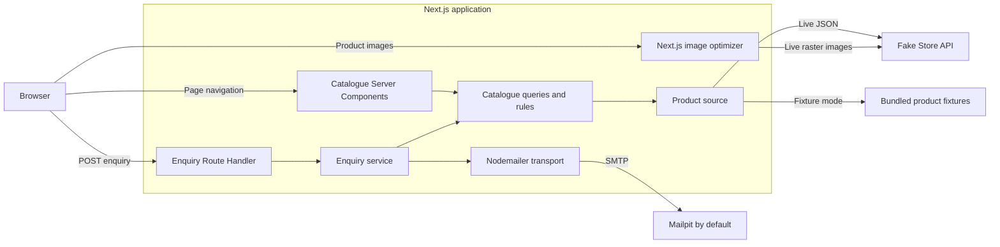
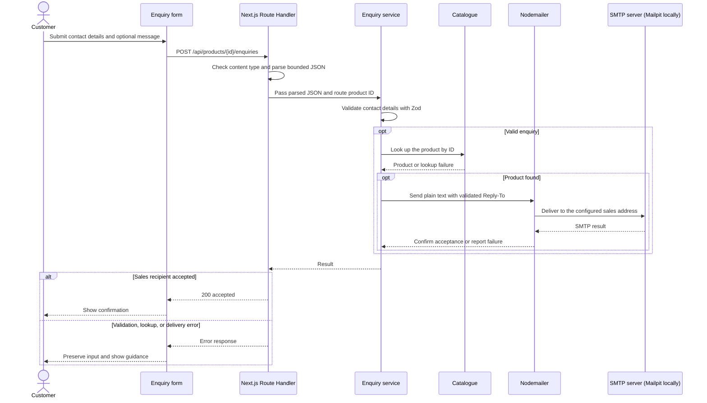

# Product catalogue

The home page shows five curated products. Customers can browse categories with top-rated and additional products or search by title and description. Product pages show the price, rating, description, and image. Each product has an enquiry form that confirms submission after the configured SMTP server accepts the message.

## Technology stack

Next.js App Router runs the React and TypeScript UI and the Node.js enquiry handler in one application. The author's App Router experience and the single deployment kept the proof of concept small. Tailwind CSS supplies the responsive layout, and Zod validates enquiry inputs and live product data. Nodemailer sends plain-text email over SMTP, and Mailpit provides a local inbox without an external service. Vitest covers catalogue and enquiry logic, while Playwright checks the browser flow and actual SMTP receipt.

## Run locally

Install Docker Engine or Docker Desktop with Docker Compose. The first build needs access to the public image and npm registries.

Run this command from the repository root to build and start the app. It uses Fake Store API by default.

```sh
docker compose up --build --detach
```

The app is at [http://localhost:3000](http://localhost:3000). Open a product, choose **Enquire**, submit sample contact details, and check the message in [Mailpit at http://localhost:8025](http://localhost:8025). Stop the stack with `docker compose down`.

After a source change, rerun `docker compose up --build` to refresh the image serving port 3000. Playwright builds a separate test image.

### Switch catalogue sources

`CATALOGUE_SOURCE` supports two values.

- `fake-store` is the default. The server reads the live catalogue from Fake Store API.
- `fixture` uses the bundled offline catalogue of eight products across two categories, with local images.

Once the image has been built, run the command for the mode you want.

```sh
# Switch to the offline fixture catalogue.
CATALOGUE_SOURCE=fixture docker compose up --detach --no-build app

# Switch back to the live Fake Store catalogue.
CATALOGUE_SOURCE=fake-store docker compose up --detach --no-build app
```

Compose recreates the app container with the selected environment value when the mode changes. Switching catalogue sources does not require rebuilding the image.

## Environment

Compose works with its built-in defaults. To customize them, copy `.env.example` to `.env` and edit the values. Compose also reads exported environment variables, which take precedence over the file. Use synthetic contact details for local enquiries and keep credentials out of Git.

| Variable | Compose default | Purpose |
| --- | --- | --- |
| `CATALOGUE_SOURCE` | `fake-store` | Select `fake-store` for the live catalogue or `fixture` for the bundled catalogue. |
| `SMTP_HOST`, `SMTP_PORT` | `mailpit`, `1025` | SMTP endpoint used by the server. Mailpit's SMTP port stays inside the Compose network. |
| `SMTP_SECURE` | `false` | Set to `true` for implicit TLS. Authenticated connections with `false` require STARTTLS. |
| `SMTP_USER`, `SMTP_PASS` | Empty | Supply both for authenticated SMTP. |
| `MAIL_FROM`, `SALES_EMAIL` | `catalogue@example.test`, `sales@example.test` | Envelope sender and sales recipient. The customer's validated email is used as Reply-To. |

## Automated checks

Install Node.js 22.13 or newer on the 22 line, or Node.js 24. Run these checks from the repository root.

```sh
npm ci
npm run lint
npm run typecheck
npm test
npm run build
```

With Docker running, install Chromium and run the browser suite.

```sh
npx playwright install chromium
npm run test:e2e
```

Playwright starts and stops a separate Compose project using `compose.test.yaml`. It uses fixture data and unauthenticated local Mailpit with `catalogue-e2e@example.test` as sender and `Sales-E2E@EXAMPLE.TEST` as recipient. The test project uses fixed settings and skips the normal `.env` file. Keep `127.0.0.1:3100` for the test app and `127.0.0.1:8125` for its inbox available. Playwright refuses to reuse a running app on the test port.

### Final verification

- 52 Vitest tests and 9 Playwright tests passed.
- ESLint and TypeScript checks passed.
- The Next.js and Docker production builds passed.
- `npm audit` and `npm audit --omit=dev` both reported zero vulnerabilities at the last check.

## Architecture





## Limitations and supporting notes

- Live browsing and enquiries depend on Fake Store availability. Fixture mode provides eight products in two categories. Fixture images and their upstream license are included. [Image sources](https://github.com/keikaavousi/fake-store-api/tree/master/public/img) · [License](public/catalogue-fixtures/LICENSE)
- Product data and enquiries have no application database. Mailpit is the local sales inbox. If an SMTP response is lost after delivery, retrying can send a duplicate.
- The default setup is intended for local review. See the decisions for assumptions and production considerations, and the AI usage notes for verification and the outstanding author entries. [DECISIONS.md](DECISIONS.md) · [AI_USAGE.md](AI_USAGE.md) · [PLAN.md](PLAN.md)
